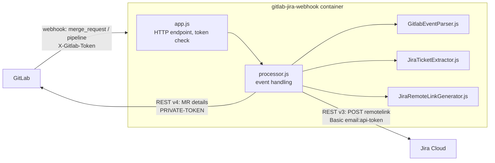
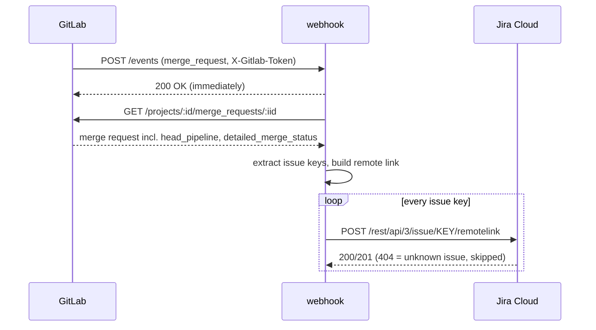

# Design: gitlab-jira-webhook

## Purpose and scope

GitLab merge requests that mention a Jira issue key (`PROJ-123`) should show up on that issue in
Jira, with their current state: open, draft, needs rebase, pipeline running/failed, merged, closed.

The service receives GitLab project webhooks and maintains one Jira *remote link* ("web link") per
merge request on every issue the merge request mentions. The link is updated in place whenever the
merge request or its pipeline changes.

In scope: GitLab (self-managed or gitlab.com) → Jira Cloud, merge request and pipeline events.
Out of scope: commits, branches and deployments (the official GitLab-for-Jira app covers those when
GitLab is reachable from the internet), and Jira Data Center authentication.

## Components

| Module | Responsibility |
| --- | --- |
| `src/server.js` | Entry point: loads `.env`, config, wires clients, starts HTTP, graceful shutdown |
| `src/config.js` | Reads and validates environment variables, maps deprecated 1.x names |
| `src/app.js` | Express app: `GET /` health, `POST /events` with constant-time token check |
| `src/processor.js` | Finds the merge requests an event concerns, re-reads them, upserts the links |
| `src/GitlabEventParser.js` | GitLab REST merge request → flat internal event |
| `src/JiraTicketExtractor.js` | Issue keys from source branch, title and description |
| `src/JiraRemoteLinkGenerator.js` | Internal event → Jira remote link object (icons, titles, status) |
| `src/gitlabClient.js`, `src/jiraClient.js`, `src/http.js` | `fetch` wrappers with timeout and retry |
| `src/check.js` | Self-check of config and credentials (`npm run check`) |

The only runtime dependency is Express. HTTP uses Node's built-in `fetch`.

## Flows

### Merge request event

The merge request is always re-read from the API instead of using the webhook payload. The payload
has no pipeline status, and the API returns the current state even when events arrive out of
order.

### Pipeline event

GitLab sends no merge request event when only the pipeline changes, and a merge request that
conflicts on its first push gets no further merge request events at all. So pipeline events are
mapped back to merge requests:

1. Merge request pipelines carry a `merge_request` object in the payload; its `iid` and
   `target_project_id` are used directly.
2. Branch pipelines don't. Their merge requests are looked up with
   `GET /projects/:id/repository/commits/:sha/merge_requests`.

From there the flow is the same as for a merge request event. Duplicate merge requests within one
event are processed once.

## Remote link mapping

Every link has:

| Field | Value |
| --- | --- |
| `globalId` | `gitlabUrl=<encoded GitLab origin>/&projectId=<target project id>&mergeId=<MR global id>` |
| `relationship` | target project path, e.g. `group/project` (Jira groups links by it) |
| `object.title` | `!<iid> <merge request title>` |
| `object.summary` | last update, `YYYY/MM/DD HH:mm` in the container's `TZ` |
| `object.icon` | merge request state (below) |
| `object.status.icon` | the most relevant status (below), linking to the MR or pipeline |
| `object.status.resolved` | `true` for merged and closed; Jira shows these struck through |

**Idempotency:** Jira's remote link API updates the existing link when the `globalId` matches. The
`globalId` depends only on the GitLab host and the merge request, so each event replaces the
previous state. The format is unchanged from 1.x, so links created by the old version are updated
rather than duplicated.

**Object icon:** `opened` → pull request, `locked` → lock, `merged` → merge, `closed` → "Canceled
Merge Request".

**Status icon.** The first rule that applies wins:

1. Merged or closed: same as the state.
2. Pipeline `created`/`waiting_for_resource`/`preparing`/`pending`/`scheduled`/`manual` → pending,
   `running` → running, `failed` → failed, `canceling`/`canceled` → canceled. These link to the
   pipeline.
3. Otherwise `detailed_merge_status`:

| `detailed_merge_status` | Icon key | Title |
| --- | --- | --- |
| `mergeable` | `can_be_merged` | Can be merged |
| `unchecked`, `checking`, `preparing`, `approvals_syncing` | `unchecked` | Unchecked / Checking mergeability / … |
| `conflict`, `broken_status` | `cannot_be_merged` | Has conflicts / Cannot be merged |
| `need_rebase` | `need_rebase` | Needs rebase |
| `draft_status` | `draft` | Draft |
| `not_approved`, `requested_changes` | `needs_review` | Awaiting approval / Changes requested |
| `discussions_not_resolved` | `discussions` | Unresolved discussions |
| `ci_must_pass`, `ci_still_running` | `pending`, `running` | Pipeline must succeed / still running |
| anything else | `blocked` | Blocked: *status in words* |

A successful pipeline falls through to the merge status, which says more ("Can be merged",
"Awaiting approval"). On GitLab versions without `detailed_merge_status`, the deprecated
`merge_status` is mapped onto it.

Icons come from `icon-url-map.json`. A custom map (`ICON_URL_MAP_PATH`) only needs the keys it
overrides. Jira Cloud loads the icons from the browser, so the URLs must be publicly reachable.

## Issue key detection

The pattern is `[A-Z][A-Z0-9_]+-\d+`. It must not touch a letter, digit or underscore on the left
or a digit on the right. Keys are uppercase only, as Jira stores them. Branch names with lowercase
keys (`feature/proj-12`) are not matched.

Things like `UTF-8` or `ISO-9001` also match. Jira answers 404 for those, and that is logged as
"not found" rather than as an error. Setting `JIRA_PROJECT_KEYS` avoids the calls entirely.

## Configuration

| Variable | Required | Description |
| --- | --- | --- |
| `GITLAB_BASE_URL` | yes | e.g. `https://git.example.org` |
| `GITLAB_TOKEN` | yes | `read_api` token that can see the hooked projects (1.x: `GITLAB_PERSONAL_ACCESS_TOKEN`) |
| `GITLAB_WEBHOOK_TOKEN` | yes | Secret configured on the GitLab hook |
| `JIRA_BASE_URL` | yes | `https://<site>.atlassian.net` |
| `JIRA_EMAIL` | yes | Atlassian account email (1.x: `JIRA_USERNAME`) |
| `JIRA_API_TOKEN` | yes | Atlassian API token (1.x: `JIRA_PASSWORD`) |
| `JIRA_PROJECT_KEYS` | no | Comma-separated allowlist of Jira project keys |
| `PORT` | no | Listen port, default 3000 |
| `LOG_LEVEL` | no | `error`, `warn`, `info` (default), `debug` |
| `TZ` | no | Time zone of the link summary date |
| `REQUEST_TIMEOUT_MS` | no | Per-request timeout towards GitLab/Jira, default 10000 |
| `ICON_URL_MAP_PATH` | no | Path to a custom icon map |
| `STORE_EVENTS_DIR` | no | Debugging: write every received payload to this directory |
| `NODE_EXTRA_CA_CERTS` | no | CA bundle for a GitLab with a private CA |
| `HTTPS_PROXY`, `NO_PROXY`, `NODE_USE_ENV_PROXY=1` | no | Outgoing proxy |

Startup fails with a list of everything missing or invalid. Deprecated 1.x names still work and log
a warning. Removed settings (`JIRA_PFX_*`, `JIRA_HTTPS_PROXY`) log a hint.

## Security

- **Webhook authentication:** `X-Gitlab-Token` is checked before the body is parsed, using a
  constant-time comparison of SHA-256 digests. The token is never logged.
- **TLS:** certificates are always verified. A GitLab with a private CA is trusted by adding its CA
  through `NODE_EXTRA_CA_CERTS`, not by disabling verification.
- **Least privilege:** the GitLab token needs only `read_api`. The Jira account needs only "Browse
  projects" and "Link issues". The registration script uses a separate Maintainer/admin token that
  the container never sees.
- **Container:** non-root user, read-only root filesystem, all capabilities dropped,
  `no-new-privileges`, memory limit. By default it listens on `127.0.0.1` only.
- **Event dumps** (`STORE_EVENTS_DIR`) contain full payloads with user data. The file name is
  sanitized and the feature is meant for debugging only.

## Failure handling

- The HTTP response goes out before any processing, so GitLab never waits on Jira. Slow or failing
  hooks are flagged by GitLab and can get disabled.
- Every outgoing request has a timeout and one retry on network errors, 429 and 5xx, honoring
  `Retry-After` (capped at 30 s). Re-posting a remote link is safe thanks to the `globalId`.
- Errors are contained per merge request and per issue: one failing Jira issue doesn't block the
  others, and nothing can crash the process. 1.x died on the first unhandled rejection.
- No queue or persistence: an event that fails after the retry is lost, but the next event for the
  same merge request (any update, any pipeline status change) restores the link.
- `SIGTERM` stops accepting connections and waits up to 15 s for in-flight work.
- Events processed concurrently can finish out of order. Each reads the current merge request
  state, so the last write is at most one event stale and is corrected by the next one.

## Limits and known behavior

- Jira's issue view collapses long lists of web links. Many merge requests on one issue stay linked
  but are less visible.
- Merge request comments, approvals and label changes only arrive with "merge request events", and
  only if GitLab sends an event for them. The status is refreshed with the next event.
- Closed merge requests keep their link (shown as resolved). Links are never deleted.
- Links of a merge request that stops mentioning an issue stay on that issue.

## Deployment

The service is a single stateless container, built from the `Dockerfile` (`node:24-alpine`,
production dependencies only, health check on `GET /`). `deploy/` contains the scripts for running
it next to a GitLab Omnibus installation and for registering the project hooks. See
[DEPLOY.md](DEPLOY.md).

## Changes from 1.x (review findings)

| # | Finding in 1.x | Resolution |
| --- | --- | --- |
| 1 | Promise rejections from `got` were unhandled; on Node ≥ 15 any GitLab/Jira error killed the process | All work runs in contained tasks; errors are logged per merge request/issue |
| 2 | `NODE_TLS_REJECT_UNAUTHORIZED=0` disabled TLS verification globally | Removed; private CAs via `NODE_EXTRA_CA_CERTS` |
| 3 | Webhook token logged and compared with `!==` | Never logged; constant-time comparison, before body parsing |
| 4 | `STORE_EVENTS` built the file name from the request body (path traversal) | Event kind sanitized; directory configurable |
| 5 | date-fns 1 format tokens (`YYYY/MM/DD`) break silently on date-fns ≥ 2 | `Intl.DateTimeFormat`, honoring `TZ` |
| 6 | got 9 API (`json: true`, `auth`) is gone in current got | Native `fetch` |
| 7 | Deprecated GitLab fields: `merge_status`, `work_in_progress`, MR `pipeline`, URLs without `/-/` | `detailed_merge_status`, `draft`, `head_pipeline` with fallbacks; pipeline URL from the API |
| 8 | `/rest/api/latest` with username/password | Jira Cloud `/rest/api/3` with email + API token |
| 9 | Issue regex matched inside words; every match hit Jira | Word boundaries, optional project allowlist, 404 treated as "not found" |
| 10 | Pipeline success/canceled and most merge blockers were not shown | Full status mapping (above) |
| 11 | Branch pipeline lookups refetched MRs in the pipeline's project, which is wrong for forks | Uses each MR's own `project_id` |
| 12 | Node 10, Jest 24, nodemon in prod dependencies, dev dependencies in the image | Node 24, `node:test`, only Express at runtime, `npm ci --omit=dev` |
| 13 | No graceful shutdown, no health check, root-owned app writable at runtime | SIGTERM handling, Docker `HEALTHCHECK`, read-only container |
